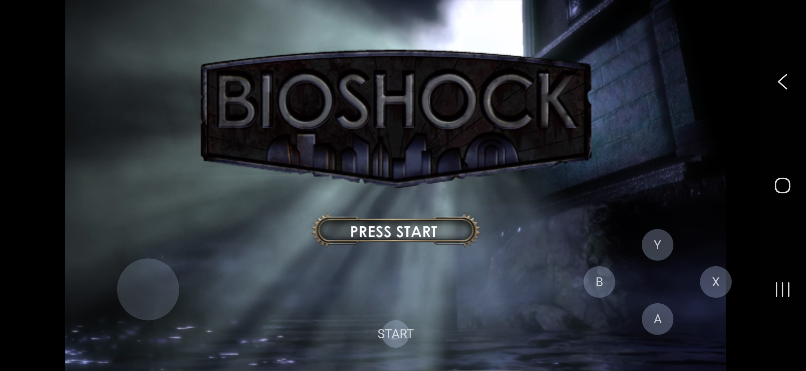

# BioShock 1 — Native ReComp (Windows + Android)

[](https://discord.gg/aaDRJQNw8T)

> **Community & Testing Feedback:** Join the Discord server to report bugs, share device performance, and follow progress: **https://discord.gg/aaDRJQNw8T**
>
> **Required Game Version:** Built against the **Xbox 360 World Release** of BioShock 1 (**Title ID: `545407D8`**, **Media ID: `44E704F7`**). Make sure you own/dump this retail edition (other regional or re-release builds with different Media IDs are not supported).

> **Release `v0.0.5.3-experimental`** — BioShock 1 runs natively on both **Windows** and
> **Android** through a **static recompilation** pipeline and the **real ReXGlue
> runtime**, featuring custom Xenos GPU renderers (**D3D11** on Windows, **OpenGL ES 3.2**
> on Android) with live no-restart resolution scaling (`360p`–`2160p`), working in-game
> **Save / Load**, **native AAudio sound** on Android, a **full Xbox 360 on-screen touch
> controller**, and Bink cutscene / performance optimizations.

| Platform | Status | Evidence |
|---|---|---|
| Windows (x86_64, Custom D3D11 / D3D12) | ✅ In-game playable with live `360p`–`2160p` scaling, Lanczos2 upscale, audio & saves | [`docs/screenshots/host-title.png`](docs/screenshots/host-title.png) |
| Android (arm64-v8a, Custom GLES 3.2 / Vulkan) | ✅ In-game playable with live `360p`–`1440p` scaling, AAudio sound, full Xbox 360 touch controls & saves | [`docs/screenshots/android-title.png`](docs/screenshots/android-title.png) |



*The on-device result: the genuine "BIOSHOCK" title sign, "PRESS START", and the
animated underwater-city background — produced by guest-presented frames, **not**
a painted or faked image. The round overlay buttons are the optional SDL touch
controls.*

---

## What this is

A host-side **static recompilation** pipeline plus launchers for **Windows** and
**Android** that turn *your legally-owned* Xbox 360 BioShock disc into native
code:

- **No emulator loop, no JIT.** PPC guest code is translated ahead-of-time into
  C++ (`recomp/generated/`), compiled for the target, and executed natively.
- **The real runtime.** Rendering, kernel, HLE imports and the filesystem come
  from [ReXGlue SDK v0.11.0](https://github.com/rexglue/rexglue-sdk), not a
  hand-written approximation.
- **Guest-presented frames.** The title appears through the real Xenos GPU
  command processor → `VdSwap` → `vkQueuePresentKHR` path.
- **Full Xbox 360 on-screen touch controller (Android).** The custom multi-touch
  overlay (`TouchControlsView.kt`) provides dual floating analog sticks (MOVE +
  LOOK), analog/digital triggers and bumpers (`LT`, `LB`, `RT`, `RB`), a 4-way
  `D-Pad`, face buttons (`A`, `B`, `X`, `Y`), thumbstick clicks (`L3`, `R3`),
  `BACK`, and `START`, plus a live `RES` pill (`360p`–`1440p`) and `HUD` toggle.
- **Custom Xenos renderers (Windows D3D11 + Android OpenGL ES 3.2).** Replaces
  the default backend with standalone Xenos renderers (`renderer/`,
  `rexgpu-xenos-custom`) supporting **live, no-restart internal resolution
  scaling** (`360p`–`2160p` on Windows via **F1**; `360p`–`1440p` on Android via
  the **RES** button, default `540p` on fresh installs), live **Lanczos /
  Bilinear** present filter toggle (**F2**), async FIFO shader compilation + disk
  cache, tiered texture change-detection, fast row-copy Bink video uploads, and
  RRRR depth-channel replication for underwater fog and lighting. See
  [`docs/33-CUSTOM-RENDERER.md`](docs/33-CUSTOM-RENDERER.md).
- **Working in-game Save / Load & native Android audio.** Full Xbox 360
  `SaveGames:` container (`DLContentInfo.pkg` / `.bsg`) and profile persistence
  work on both Windows and Android, paired with a native `libaaudio.so` 48 kHz
  stereo audio driver on Android.
- **No game data in the APK or Windows zip.** The launcher asks you to import
  your own Xbox 360 World Release ISO (or extracted game folder on Windows);
  nothing proprietary is committed or shipped.

## What this is *not*

- Not a 1.0 finished product — releases are labeled `experimental` as edge-case
  shader, lighting, and performance tuning continues across the campaign.
- Not an emulator — there is no interpreter or JIT fallback.
- Not a distribution of BioShock, its assets, the Xbox 360 BIOS, or any
  Microsoft material. **You must own a legal copy of the Xbox 360 World Release
  (`Title ID 545407D8`, `Media ID 44E704F7`).**

---

## How it works

```
  Xbox 360 ISO (yours)
        │  tools/pipeline.py inspect
        ▼
  default.xex  →  XEX analysis JSON  →  recompiler config (config/)
        │  ReXGlue recompiler (rexglue.exe)
        ▼
  recomp/generated/  (PPC → C++ translation units)
        │
        ├──────── Windows ────────►  native/ + ReXGlue D3D12 runtime
        │                              → bioshock1.exe  → real title screen
        │
        └──────── Android ────────►  JNI bridge (_work/rexglue-android-app/)
                                     + ReXGlue Vulkan runtime (arm64)
                                     → app-debug.apk  → real title screen
```

The Android launcher is a Kotlin `SurfaceView` app that forwards the native
surface to SDL3 and pumps frames from JNI. The native side hosts the real
ReXGlue `TitleApp`: kernel, 4 GB guest address space, Vulkan GPU backend, and
the generated PPC→C++ code. Game files are imported via the Android document
picker and extracted into `files/game/`.

Key technical fixes required to reach the title screen (all documented and
shipped as patches in [`patches/`](patches/)):

1. **SPIR-V translator** — glslang's `createAccessChain(storage, base, offsets)`
   derived its result type from internal state the SDK never initializes,
   producing invalid SPIR-V that crashed the Adreno driver. Patched to derive
   the type from the actual `base`/`offsets` arguments.
2. **Presenter surface connection** — under the headless SDL bootstrap the
   resize event never reached the UI layer, so presents were silently skipped.
   Added `App::NotifySurfaceResized()` and called from the JNI `nativeResize`.
3. **Host allocator stability** — a `std::string` free in `PosixThread::SetName`
   corrupted the heap on a guest thread; the Android path now skips the
   non-essential thread-name surgery.

See [`docs/32-GOAL-ANDROID-TITLE.md`](docs/32-GOAL-ANDROID-TITLE.md) for the
full debugging story and evidence.

---

## Quick start

### Prerequisites

- **Windows:** PowerShell 7, Python 3.11+, CMake 3.25+, MinGW or MSVC, Java 17+
  (for the Android build), Android SDK + NDK r30.
- **Android device:** arm64-v8a, Android 9+, a Vulkan-capable GPU. Tested on a
  Samsung SM-A366B (Adreno, Android 16).
- **Game:** your own BioShock 1 Xbox 360 ISO. `default.xex` is 13,021,184 bytes
  (title `0x545407D8`, XDK 5426).

### 1. Fetch dependencies

The large third-party toolchains and the ReXGlue SDK are **not vendored in this
repository** (see [`third_party/README.md`](third_party/README.md)). Run the
provided installers:

```powershell
python tools/pipeline.py inspect        # ISO → default.xex → analysis JSON
python tools/pipeline.py configure      # → config/bioshock1.toml
./scripts/install-toolchain.ps1         # fetch codegen toolchain into tools-bin/
./scripts/install-rexglue.ps1           # fetch ReXGlue v0.11.0 SDK
```

Apply the Android port patches from [`patches/`](patches/PATCHES.md) to a clean
`third_party/rexglue-git` checkout before building for Android.

### 2. Generate the recompiled code and build the Windows launcher

```powershell
python tools/pipeline.py build-native   # host selftest + native build
.\run-windows.ps1                       # 1920x1080 fullscreen, real title screen
```

`run-windows.ps1` is the recommended way to launch: the runtime otherwise
defaults to a **1280x720 window with 1x internal resolution**, which looks very
low on a modern monitor. The script sets `--ui.resolution=1920x1080` (window and
the video mode the guest sees) and supports optional supersampling:

```powershell
.\run-windows.ps1 -Scale 2                        # sharper: 2x internal resolution
.\run-windows.ps1 -Resolution 2560x1440 -Scale 2 -Windowed
```

If you prefer to run the exe directly, pass the same flags yourself:
`bioshock1.exe --ui.resolution=1920x1080 --gpu.resolution_scale_x=2 --gpu.resolution_scale_y=2`.

**In-game resolution toggle:** press **F1** in the Windows build to cycle the
internal draw resolution `1x → 2x → 3x → 1x`. The console prints the new scale
and the title reloads so the GPU caches rebuild with the new value (the guest
returns to the title screen, so this is best for A/B comparison rather than
mid-gameplay). You can confirm the applied value in the log — look for
`BS1: requested draw resolution scale = NxN`. The launcher defaults to **2x**
because the guest's native 1x output is blurry when upscaled to a modern
monitor; use `-Scale 1` for the original internal resolution.

### 3. Build and install the Android launcher

```powershell
python tools/pipeline.py build-apk
adb install -r android\app\build\outputs\apk\debug\app-debug.apk
```

On first launch, tap **IMPORT ISO**, pick your BioShock ISO, wait for the full
game tree to extract, then tap **START GAME**. The title sequence plays shortly
after. Game data never leaves your device.

---

## Repository layout

| Path | Contents |
|---|---|
| `native/` | Windows host launcher: PPC context, HLE kernel, Xenos PM4, JNI bridge helpers |
| `renderer/` | Standalone custom D3D11 Xenos renderer module (`rexgpu-xenos-custom`) with live resolution & filter control |
| `recomp/` | Generated PPC→C++ output (generated files are gitignored) |
| `android/` | Android Kotlin launcher (`app/src/main/java`), manifest, resources, Gradle build |
| `tools/` | Host pipeline: ISO/XEX parsing, config generation, build orchestration |
| `scripts/` | Toolchain installers, verification, docs indexer |
| `config/` | Real XEX analysis JSON + generated recompiler TOML |
| `patches/` | ReXGlue SDK + glslang patches required for Android rendering |
| `docs/` | 32 detailed documents, including the goal/worklog and this page's evidence |
| `third_party/` | Dependency notes only — toolchains are fetched at build time |

---

## Documentation

Start at [`docs/00-START-HERE.md`](docs/00-START-HERE.md). Highlights:

| Doc | Topic |
|---|---|
| [`01-ARCHITECTURE.md`](docs/01-ARCHITECTURE.md) | How the pieces fit; why static recompilation |
| [`02-TOOLCHAIN.md`](docs/02-TOOLCHAIN.md) | Every tool and its role |
| [`03-XEX-ANALYSIS.md`](docs/03-XEX-ANALYSIS.md) | Real facts from the game dump |
| [`05-BUILDING.md`](docs/05-BUILDING.md) | Exact build commands |
| [`10-STATUS.md`](docs/10-STATUS.md) | Honest, verified status |
| [`19-WORKLOG.md`](docs/19-WORKLOG.md) | Full incremental journal (sessions 1–16) |
| [`31-GOAL-TITLE-SCREEN.md`](docs/31-GOAL-TITLE-SCREEN.md) | Windows title-screen breakthrough |
| [`32-GOAL-ANDROID-TITLE.md`](docs/32-GOAL-ANDROID-TITLE.md) | Android title-screen breakthrough |
| [`13-LEGAL.md`](docs/13-LEGAL.md) | Legal notes |

Verification is green: `python scripts/verify-all.py` → **12/12 checks passed**.

---

## Releases

Releases follow an **experimental** pre-1.0 scheme:

- **`v0.0.1-experimental`** — First verified guest-rendered title screen on both
  Windows and Android. Source snapshot; binaries are built locally from source.
- **`v0.0.2-experimental`** — Android dual-stick touch controls, Windows launcher
  improvements, and live Lanczos2 present upscaling.
- **`v0.0.3-experimental`** — Standalone custom D3D11 Xenos renderer for Windows
  (`rexgpu-xenos-custom`) with live no-restart internal resolution scaling
  (`360p`–`2160p`), async FIFO shader compilation + disk cache, fast texture
  untiling, strict D3D11 binding/hazard fixes eliminating multipass flickering,
  and kernel critical-section stability fix.
- **`v0.0.4-experimental` / `v0.0.4.20-experimental`** — Custom OpenGL ES 3.2
  Xenos renderer for Android (`rexgpu-xenos-custom`) with live `360p`–`1440p`
  scaling (`RES` pill), native Android 48 kHz AAudio driver (`libaaudio.so`),
  full Xbox 360 on-screen touch controller (dual floating sticks, LT/LB/RT/RB,
  D-Pad, A/B/X/Y, L3/R3, BACK/START), and in-game Save / Load fixes
  (`ObDosDevices` root directory handle resolution, `\??\` prefix stripping,
  Android SELinux `MoveNoReplace` rename fix, and numeric profile settings).
- **`v0.0.5-experimental`** — Performance & cutscene optimization release for
  Android and Windows: display-priority GPU worker thread, Android sustained
  performance mode, tiered texture fingerprint change-detection, fast row-copy
  Bink video uploads, `RRRR` resolved depth replication for underwater fog/lighting,
  and `540p` / `2x` anisotropy default on fresh Android installs.
- **`v0.0.5.3-experimental` (Cutscene + Audio Fix Again)** — Ahead-of-time GLES 3.2
  shader binary pre-warming at startup (`PrewarmCache` + lazy `glCompileShader`),
  hardware `IPhysicalWriteWatch` page tracking for textures/VBs/IBs, resolved
  render-target CPU-overwrite invalidation, VSync enabled (`--gpu.custom.vsync=true`),
  removal of `sustainedPerformanceMode` clock throttling and GPU thread `-8` priority
  starvation, and clean `AAUDIO_PERFORMANCE_MODE_LOW_LATENCY` audio with sample-rate
  resampling (no audio stretching).

See the [Releases page](../../releases) for notes.

---

## Legal

No game data, BIOS, ISO, XEX, or proprietary Microsoft material is included or
shipped in this repository or its releases. The included screenshots are
documentation evidence of the port, not game assets. You must own a legal copy
of BioShock 1 to use this project. See [`docs/13-LEGAL.md`](docs/13-LEGAL.md).

ReXGlue SDK and Xenia-derived runtime code are BSD-3-Clause licensed (see the
upstream project); this project's original code follows the same license unless
noted otherwise.
